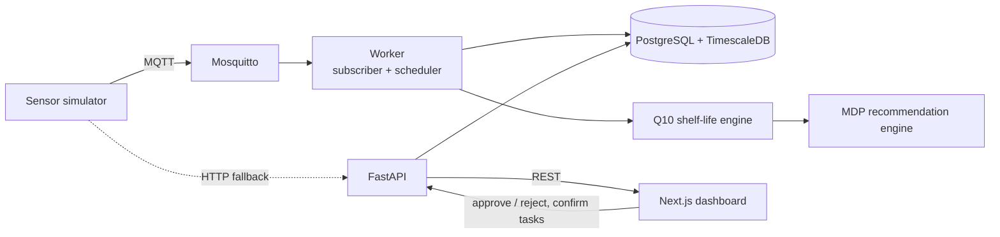

# Dynamic Perishable Inventory Management System

**With Sensor-Based Shelf-Life Tracking** (JAM SOFT capstone)

A decision-support system that replaces static expiry dates with shelf-life estimates computed from temperature and humidity telemetry. A Markov Decision Process (MDP) decides when each batch should be held, sent out first (priority dispatch), or pulled from sale (salvage). A human supervisor approves or rejects every recommendation, and warehouse staff confirm each approved order.

> **Status:** Working prototype, about 93% of planned features done (November 2026). Sensors are simulated by design (no physical hardware), and the shelf-life data is synthetic.

---

## Table of Contents

1. [Overview](#overview)
2. [Key Features](#key-features)
3. [Scope and Limitations](#scope-and-limitations)
4. [System Architecture](#system-architecture)
5. [Tech Stack](#tech-stack)
6. [Repository Structure](#repository-structure)
7. [Getting Started](#getting-started)
8. [API Overview](#api-overview)
9. [Shelf-Life Model](#shelf-life-model)
10. [Decision Model (MDP)](#decision-model-mdp)
11. [Evaluation](#evaluation)
12. [Progress](#progress)

---

## Overview

First-Expired, First-Out (FEFO) handling relies on the date printed on the package. That date does not reflect shelf life lost to cold-chain breaks and thermal abuse. This system estimates **Remaining Useful Life (RUL)** per batch from sensor readings and uses it to:

- Order dispatch by remaining life (dynamic FEFO)
- Recommend priority dispatch or salvage, using lines found by an MDP
- Let a supervisor approve or reject every recommendation
- Turn approved recommendations into tasks that staff confirm or flag

The approach follows Herron et al. (2022) for cold-chain shelf-life loss and Buisman et al. (2019) for dynamic shelf life.

## Key Features

| Feature | Description |
|---|---|
| Dynamic shelf-life estimation | Q10 temperature model, computed per batch from its own chiller's readings |
| MDP recommendations | Dispatch and salvage lines per product, solved by value iteration; warm chillers get earlier lines |
| Human-in-the-loop | Recommendations stay `pending` until a supervisor decides. Every decision is written to an audit log |
| Staff tasks | Approved recommendations appear on the staff pull list, where staff mark them done or flag them |
| Dashboard | Overview, stock, analytics, chiller map, decisions, and change history; refreshes every 5 seconds |
| Offline demo | Runs on one laptop with Docker Compose, with no internet needed |

## Scope and Limitations

**In scope**
- Temperature and humidity sensing from a simulator (one per chiller) that uses the ESP32 message format; no physical sensor hardware
- Products: fresh chicken breast, fresh milk and a tomato-based dish, each in its own chiller (A, B, C)
- Two roles: `supervisor` (manages batches and sensors, approves or rejects) and `staff` (views the pull list, confirms or flags tasks)

**Out of scope**
- Inventory record-keeping: stock movements, purchase orders, POS, and accounting
- Price changes, markdowns, and discounting
- Gas and VOC sensors, and computer vision
- Paid external APIs at runtime

**Limitations**
- Shelf-life parameters are fitted to a synthetic, LLM-generated dataset, not to field data
- Humidity is simulated and does not affect shelf life
- Evaluation results come from simulation, not field trials
- Sign-in uses two seeded demo accounts (`demo-supervisor`, `demo-staff`; dev passwords in `.env.example`). There is no account management screen, MFA or HTTPS yet

## System Architecture



1. Each chiller's simulator publishes readings to `sensors/{device_id}/telemetry` over MQTT. `POST /api/v1/telemetry` accepts the same payload.
2. The worker validates and stores the readings in a TimescaleDB hypertable.
3. Every 30 seconds the worker recomputes each batch's RUL, then refreshes its recommendation using the MDP lines.
4. The dashboard reads everything over REST and refreshes every 5 seconds.
5. A supervisor approves or rejects each recommendation. Approved ones become staff tasks. Every action is written to the audit log.

## Tech Stack

| Layer | Technology |
|---|---|
| Language | Python 3.12 (backend), TypeScript (frontend) |
| API | FastAPI, Pydantic v2, `pydantic-settings` |
| Database | PostgreSQL 16 + TimescaleDB, SQLAlchemy 2.x, Alembic, psycopg 3 |
| Ingestion | Mosquitto (MQTT) with `paho-mqtt`, plus an HTTP fallback |
| Scheduler | APScheduler in the `worker` service |
| Shelf-life and MDP engines | Python standard library only (no I/O) |
| Tests / lint | pytest, httpx, ruff |
| Containers | Docker Compose |
| Frontend | Next.js, with types generated from OpenAPI by `openapi-typescript` |

## Repository Structure

```
.
├── docker-compose.yml
├── backend/
│   ├── alembic/               # migrations
│   ├── app/
│   │   ├── main.py            # FastAPI app factory
│   │   ├── core/              # config, roles, errors, product config
│   │   ├── db/                # models, seed
│   │   ├── schemas/           # Pydantic models
│   │   ├── api/v1/            # routers
│   │   ├── services/          # business logic
│   │   ├── engine/            # rul.py (Q10), mdp.py (MDP), recommend.py (no I/O)
│   │   ├── ingest/            # MQTT subscriber
│   │   └── worker.py          # scheduled jobs
│   └── tests/
├── simulator/sim.py           # ESP32-compatible sensor simulator
├── data/                      # products.yaml, shelf_life_by_temperature.csv
├── scripts/evaluate.py        # static FEFO vs dynamic comparison
├── docs/                      # API changelog, design docs
├── infra/mosquitto/
└── frontend/                  # Next.js dashboard
```

## Getting Started

### Prerequisites
- Docker with Docker Compose. Nothing else is installed on the host.

### Run
```bash
docker compose --profile ui up -d --build     # full system, including the dashboard
```

- Dashboard: `http://localhost:3000`. Sign in as Supervisor or Staff (demo build: passwords are not checked yet).
- API: `http://localhost:8000`, with docs at `/docs`

The database is seeded on first start: a supervisor and a staff user, the three products and chillers, and nine batches. About 30 seconds later the worker raises the first recommendations: priority dispatch for CHK-004 and MLK-002, and salvage for CHK-005 and TOM-002.

### Simulator scenarios
```bash
SCENARIO=ltl_abuse SIM_SPEEDUP=60 docker compose up -d simulator      # Chiller A (chicken)
SCENARIO_B=ltl_abuse SIM_SPEEDUP=60 docker compose up -d simulator-b  # Chiller B (milk)
SCENARIO_C=ltl_abuse SIM_SPEEDUP=60 docker compose up -d simulator-c  # Chiller C (tomato dish)
```
Scenarios: `normal`, `door_open`, `compressor_failure`, `ltl_abuse`, `recover`. `SIM_SPEEDUP` moves virtual time forward faster, so decay shows up within minutes. Each simulator's normal temperature and humidity come from `BASE_TEMP_C` and `BASE_HUMIDITY_PCT` in `docker-compose.yml`.

**Reset the demo** after any sped-up run, or shortly before presenting: `docker compose --profile ui down -v` then `up -d` again. This wipes readings, decisions and history. The seeded dispatch recommendations turn into salvage about 5 hours after a reset.

### Tests
```bash
docker compose run --rm api pytest -q     # 145 tests
```

## API Overview

All endpoints are under `/api/v1`. The OpenAPI spec is served at `/openapi.json`. Breaking and notable changes are listed in `docs/CHANGELOG-API.md`.

| Method | Endpoint | Role | Purpose |
|---|---|---|---|
| GET | `/health` | public | Liveness and DB/MQTT status |
| GET | `/me` | any | Current user and role |
| POST | `/telemetry` | device key | HTTP fallback ingest |
| GET | `/telemetry?zone_id=&from=&to=` | any | Reading history for charts |
| GET | `/zones` | any | Chillers with their latest reading |
| GET | `/products` | any | Product shelf-life settings |
| GET, POST | `/batches` | GET any, POST supervisor | Batch registry |
| GET, PATCH, DELETE | `/batches/{id}` | GET any, others supervisor | One batch with its current state |
| GET | `/batches/{id}/rul` | any | Remaining-life history |
| GET, POST | `/devices` | GET any, POST supervisor | Sensor registry |
| PATCH, DELETE | `/devices/{id}` | supervisor | Edit or remove a sensor |
| GET | `/recommendations?status=` | any | List recommendations |
| POST | `/recommendations/{id}/decision` | supervisor | Approve or reject a recommendation |
| POST | `/recommendations/{id}/task` | staff | Mark an approved order done or flag it |
| GET | `/audit-log` | any | Change history |

## Shelf-Life Model

```
rate(T)          = max(0.5, q10 ** ((T - t_ref_c) / 10))
effective_age_h += rate(T) * dt_hours        # each gap capped at 1 h of the last reading's rate
rul_h            = max(0, shelf_life_ref_hours - effective_age_h)
rul_ratio        = rul_h / shelf_life_ref_hours
```

Products and their parameters come from `data/shelf_life_by_temperature.csv`, a **synthetic** dataset the team generated with an LLM from the research paper (fresh chicken breast: 168 h at 4 °C, `q10 = 2.97`; fresh milk: 235 h, 2.46; tomato-based dish: 131 h, 1.98). `tests/test_dataset_fit.py` checks the model stays within 10% of the dataset at every temperature. Example: two hours at 23 °C ages chicken about 15.8 hours, 13.8 hours more than at 4 °C. On the Herron et al. (2022) cyclic abuse pattern (2 h at 4 °C, then 2 h at about 23 °C) the chicken parameters lose about 3.5 days, more than the 1.5 to 2.25 days Herron measured.

### Chillers and setpoints

The seed has one chiller per product, so raw chicken never shares a room with the ready-to-eat dish. Each chiller has its own simulated sensor. The setpoints come from Philippine National Standards (PDF page numbers); the shelf-life numbers still come only from the synthetic dataset, and every setpoint sits between its 2 °C and 4 °C rows.

| Chiller | Product | Setpoint | Humidity (simulated) | Basis |
|---|---|---|---|---|
| A (`esp32-chiller-01`) | Fresh chicken breast | 2 °C | ~88 % | PNS/BAFS 103:2016 §5.8.1.3 (p. 14–15): poultry chillers 0–4 °C. PNS/BAFS 339:2022 §3.3 (p. 4): fresh chilled meat 0–4 °C |
| B (`esp32-chiller-02`) | Fresh milk | 3.5 °C | ~80 % | PNS/BAFS 210:2017 §7.1b (p. 16): milk chilled to not more than 4 °C; §8.3c (p. 19): transported at 4 °C |
| C (`esp32-chiller-03`) | Tomato-based dish | 3 °C | ~75 % | No BAFS standard covers ready-to-eat food. US FDA Food Code 2022 §3-501.16(A)(2): cold holding at 5 °C (41 °F) or less |

**Humidity is simulated and does not affect shelf life.** The dataset has no humidity data, so the model ignores it. PNS/BAFS 168:2015 §5.2.1.2.4 (p. 10) asks for temperature and humidity monitoring but gives no limits. The danger line stays at 4 °C for every chiller.

## Decision Model (MDP)

Every 6 hours a batch can be held, dispatched first, or salvaged. `backend/app/engine/mdp.py` models this as a Markov Decision Process:

- **States:** remaining-life ratio in 1% steps, plus the chiller condition (normal 4 °C or warm 23 °C, a two-state Markov chain)
- **Actions:** hold, priority dispatch, salvage
- **Rewards (agreed by the team):** a safe sale +1, a rushed dispatch +0.9, salvage +0.2; spoiling, or shipping with under 24 h of life left, −1
- **Solver:** value iteration (discount 0.99), under a second per product

The worker solves it once per product at start-up and applies the warm lines when a chiller's latest reading is above 4 °C. Each recommendation's `rationale` records the line it crossed, the chiller condition, and `policy: "mdp"`.

| Product | Dispatch below (normal / warm) | Salvage below |
|---|---|---|
| Fresh chicken breast | 0.19 / 0.44 | 0.15 |
| Fresh milk | 0.14 / 0.26 | 0.11 |
| Tomato-based dish | 0.24 / 0.36 | 0.19 |

## Evaluation

`scripts/evaluate.py` runs 50 seeded 60-day simulations (3 products, 2 chillers each, with door openings, compressor failures and Herron abuse days) and compares three policies on the same data. A unit is **lost** if it is discarded at its printed date, spoils in stock, or ships with less than 24 h of life left.

```bash
python scripts/evaluate.py --runs 50 --csv evaluation.csv
```

| Mean units per run | Static FEFO | Fixed lines (0.50 / 0.10) | MDP (used by the system) |
|---|---|---|---|
| Shipped safely | 2,870.4 | 3,247.6 | 3,330.5 |
| Shipped unsafe | 481.3 | 90.9 | 0.0 |
| **Lost** | **517.4** | **142.3** | **29.4** |

The MDP policy cut lost units by 94.3% compared with static FEFO (paired permutation test, p < 0.0001). All results come from simulation with calibrated parameters, not field trials.

## Progress

- [x] Docker Compose stack with health checks, offline
- [x] Models, migrations, and seed data (3 products, 3 chillers, 9 batches)
- [x] Q10 shelf-life engine with unit tests, including the Herron check and the dataset fit
- [x] Simulator publishing over MQTT, with the subscriber storing telemetry
- [x] Worker recomputing RUL and refreshing recommendations
- [x] MDP decision model driving the recommendations
- [x] Supervisor decision flow with audit log, and staff task confirmation
- [x] Dashboard: overview, stock, analytics, chiller map, decisions, change history, staff view
- [x] Evaluation script (static FEFO vs. dynamic)
- [ ] Password login
- [ ] Push-based live updates (the dashboard polls every 5 seconds today)
