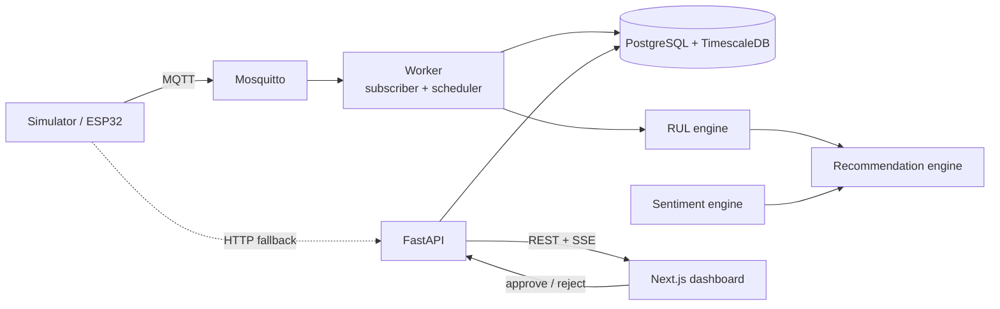

# Dynamic Perishable Inventory Management System

**With Sensor-Based Shelf-Life Tracking and NLP Sentiment Decision Support** (JAM SOFT capstone)

A decision-support system that replaces static expiry dates with shelf-life estimates computed from temperature and humidity telemetry. It analyzes customer feedback sentiment and recommends priority dispatch, markdowns, or salvage. A human supervisor approves or rejects every recommendation.

> **Status:** Prototype in active development. Sensor data comes from a simulator, and the review data is synthetic.

---

## Table of Contents

1. [Overview](#overview)
2. [Key Features](#key-features)
3. [Scope and Limitations](#scope-and-limitations)
4. [System Architecture](#system-architecture)
5. [Tech Stack](#tech-stack)
6. [Repository Structure](#repository-structure)
7. [Getting Started](#getting-started)
8. [API Overview](#api-overview)
9. [RUL Model](#rul-model)
10. [Evaluation](#evaluation)
11. [Milestones](#milestones)

---

## Overview

First-Expired, First-Out (FEFO) handling relies on the date printed on the package. That date does not reflect shelf life lost to cold-chain breaks and thermal abuse. This system estimates **Remaining Useful Life (RUL)** per batch from sensor readings and uses it to:

- Order dispatch by dynamic RUL (dynamic FEFO)
- Recommend tiered markdowns tied to remaining life
- Flag batches for salvage
- Let a supervisor approve or reject every recommendation

The approach follows Herron et al. (2022), Buisman et al. (2019), Haijema et al. (2026), and Riesenegger & Hubner (2026).

## Key Features

| Feature | Description |
|---|---|
| Dynamic shelf-life estimation | Q10 temperature-acceleration model, computed per batch from telemetry |
| Recommendation engine | Rule-based `PRIORITY_DISPATCH`, `MARKDOWN` (tiered), and `SALVAGE`, with thresholds set in config |
| NLP sentiment adjustment | Multilingual (English, Filipino, Taglish) sentiment can shift markdown depth by at most one tier |
| Human-in-the-loop | Recommendations stay `pending` until a supervisor decides. Every decision is written to an audit log |
| Live dashboard | SSE event stream plus REST endpoints, so clients can fall back to polling |
| Offline demo | Runs on a laptop with `docker compose up`, with no internet needed |

## Scope and Limitations

**In scope**
- Temperature and humidity sensing, using a simulator that sends the same payload as the future ESP32
- Primary product: fresh chicken breast. Chilled fish is optional and needs only config changes
- Labeled synthetic retail reviews for NLP
- Two roles: `staff` (read-only) and `supervisor` (can approve and reject)

**Out of scope**
- Inventory record-keeping: stock movements, purchase orders, POS, and accounting
- Gas and VOC sensors, and computer vision
- Web scraping and paid external APIs at runtime
- Price changes applied automatically

**Limitations**
- RUL parameters are placeholders until they are calibrated against Herron et al. (2022)
- Evaluation results come from simulation, not field trials

## System Architecture



1. The simulator publishes readings to `sensors/{device_id}/telemetry` over MQTT. `POST /api/v1/telemetry` accepts the same payload.
2. The worker stores telemetry in a TimescaleDB hypertable.
3. The worker recomputes RUL for each batch, then refreshes recommendations.
4. The API serves REST and pushes events over SSE to the dashboard.
5. A supervisor approves or rejects each recommendation, and the decision is written to the audit log.

## Tech Stack

| Layer | Technology |
|---|---|
| Language | Python 3.12, managed with `uv` |
| API | FastAPI, Pydantic v2, `pydantic-settings` |
| Database | PostgreSQL 16 + TimescaleDB, SQLAlchemy 2.x, Alembic, psycopg 3 |
| Ingestion | Mosquitto (MQTT) with `paho-mqtt`, plus an HTTP fallback |
| Scheduler | APScheduler in the `worker` service |
| RUL engine | NumPy, pandas |
| NLP | Hugging Face Transformers (multilingual XLM-R), with a lexicon fallback |
| Live push | SSE via `sse-starlette` |
| Auth | JWT, argon2, role claims |
| Tests / lint | pytest, pytest-asyncio, httpx, ruff, mypy |
| Containers | Docker Compose |
| Frontend | Next.js, TypeScript, with types generated from OpenAPI by `openapi-typescript` |

## Repository Structure

```
.
├── docker-compose.yml
├── .env.example
├── backend/
│   ├── alembic/               # migrations
│   ├── app/
│   │   ├── main.py            # FastAPI app factory
│   │   ├── core/              # config, security, logging
│   │   ├── db/                # engine, models, seed
│   │   ├── schemas/           # Pydantic models
│   │   ├── api/v1/            # routers
│   │   ├── services/          # business logic
│   │   ├── engine/            # rul.py, recommend.py, sentiment.py (no I/O)
│   │   ├── ingest/mqtt_sub.py # MQTT subscriber
│   │   ├── worker.py          # scheduled jobs
│   │   └── events.py          # pub/sub that feeds SSE
│   └── tests/
├── simulator/sim.py           # ESP32-compatible sensor simulator
├── data/                      # products.yaml, reviews_seed.csv, generate_reviews.py
├── scripts/evaluate.py        # static FEFO vs dynamic comparison
├── infra/mosquitto/
└── frontend/                  # Next.js dashboard
```

## Getting Started

### Prerequisites
- Docker with Docker Compose. Nothing else is installed on the host.

### Run
```bash
cp .env.example .env
docker compose up --build                  # backend stack
docker compose --profile ui up --build     # include the frontend
docker compose run --rm api python -m app.db.seed
```

- API: `http://localhost:8000`, with docs at `/docs`
- Frontend: `http://localhost:3000`

### Simulator scenarios
```bash
SCENARIO=ltl_abuse SIM_SPEEDUP=60 docker compose up simulator
```
Scenarios: `normal`, `door_open`, `compressor_failure`, `ltl_abuse`, `recover`. `SIM_SPEEDUP` moves virtual time forward faster, so decay shows up within minutes.

### Tests
```bash
docker compose run --rm api pytest -q
```

## API Overview

All endpoints are under `/api/v1`. The OpenAPI spec is served at `/openapi.json`.

| Method | Endpoint | Role | Purpose |
|---|---|---|---|
| POST | `/auth/login` | public | Exchange username and password for a JWT |
| POST | `/auth/stream-token` | any | Short-lived token for SSE |
| GET | `/me` | any | Current user and role |
| POST | `/telemetry` | device key | HTTP fallback ingest |
| GET | `/zones` | any | Zones with their latest reading |
| GET | `/telemetry?zone_id=&from=&to=` | any | Reading history for charts |
| GET | `/products` | any | Product config summary |
| GET, POST | `/batches` | GET any, POST supervisor | Batch registry |
| GET | `/batches/{id}` | any | Batch with its current state |
| GET | `/batches/{id}/rul` | any | RUL history |
| GET | `/recommendations?status=` | any | List recommendations |
| POST | `/recommendations/{id}/decision` | supervisor | Approve or reject a recommendation |
| POST | `/feedback` | any | Submit a review and get its sentiment |
| GET | `/sentiment/summary?product_id=` | any | Sentiment aggregates |
| GET | `/stream?token=` | any | SSE event stream |
| GET | `/health` | public | Liveness and DB/MQTT status |

## RUL Model

```
rate(T)          = q10 ** ((T - t_ref_c) / 10)
effective_age_h += rate(T) * dt_hours
rul_h            = max(0, shelf_life_ref_hours - effective_age_h)
rul_ratio        = rul_h / shelf_life_ref_hours
```

Chicken breast uses `t_ref_c = 4` and `q10 = 2.5`. Both are placeholders until calibration. As a sanity check, Herron et al. (2022) cyclic abuse (2 h at 4 °C, then 2 h at about 23 °C) should cost about 2.3 days of shelf life.

## Evaluation

`scripts/evaluate.py` runs seeded simulated scenarios and compares static printed-date FEFO against dynamic RUL dispatch with tiered markdowns. It measures units spoiled, units sold past their safe life, revenue recovered, and markdown depth. All results come from simulation.

## Milestones

- [ ] Compose skeleton with `/health`
- [ ] Models, migrations, and seed data
- [ ] RUL engine with unit tests, including the Herron check
- [ ] Simulator publishing over MQTT, with the subscriber storing telemetry
- [ ] Worker recomputing RUL
- [ ] Recommendation engine and the decision flow with audit log
- [ ] Auth and the SSE stream
- [ ] OpenAPI spec shared with the frontend team
- [ ] Sentiment service and seed dataset
- [ ] Evaluation script
