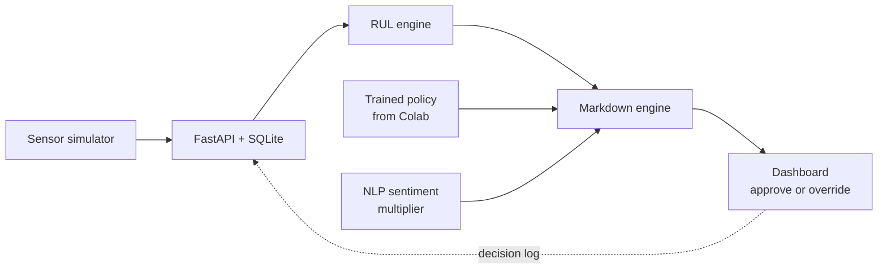

Readme · MD
# Multi-Sensor FEFO Engine with Automated Inventory Markdown and Valuation Optimization
 
A decision-support prototype that replaces static expiration dates with dynamic shelf-life estimates computed from temperature and humidity telemetry, then recommends markdown prices so aging perishable stock sells before it spoils. Final pricing decisions always stay with a human supervisor.
 
> **Status:** Prototype in active development. Sensor data is simulated and demand data is synthetic.
 
---
 
## Table of Contents
 
1. [Overview](#overview)
2. [Key Features](#key-features)
3. [Scope and Limitations](#scope-and-limitations)
4. [System Architecture](#system-architecture)
5. [Tech Stack](#tech-stack)
6. [Repository Structure](#repository-structure)
7. [Getting Started](#getting-started)
8. [API Overview](#api-overview)
9. [Machine Learning Pipeline](#machine-learning-pipeline)
10. [Project Timeline](#project-timeline)
11. [Team](#team)
12. [Future Work](#future-work)
 
---
 
## Overview
 
Traditional First-Expired, First-Out (FEFO) handling relies on fixed dates printed on packaging. Those dates cannot reflect shelf-life lost to cold-chain disruptions and thermal spikes. This project estimates **Remaining Useful Life (RUL)** from live environmental readings and uses it to:
 
- Prioritize which batches should be dispatched or sold first
- Recommend markdown discounts that shift buyers from LEFO (last-expired, first-out) to FEFO picking
- Give supervisors a dashboard to approve or override every recommendation
 
## Key Features
 
| Feature | Description |
|---|---|
| Dynamic shelf-life estimation | RUL computed per batch from temperature and humidity history |
| Markdown optimization | Rule-based baseline plus a PPO-trained policy for discount rates |
| NLP sentiment multiplier | Customer review sentiment adjusts demand and willingness-to-pay |
| Supervisory dashboard | Priority dispatch queue, freshness status, approve or override controls |
| Decision log | Every approval or override is stored for later evaluation |
| Freshness indicator | Lightweight animated character that reflects batch freshness state (visualization only) |
 
## Scope and Limitations
 
**In scope**
- Temperature and humidity monitoring (simulated sensor feed for the prototype)
- Dynamic RUL estimation replacing static expiration labels
- Markdown recommendations driven by freshness and price sensitivity
- Human-in-the-loop supervisory dashboard
 
**Limitations**
- Sensing is limited to temperature and humidity. Gas sensing is out of scope for this version.
- The system is a decision-support tool. It does not act as an official inventory ledger or execute price changes autonomously.
- Models assume controlled storage and retail environments and do not account for disruptions outside the monitored area.
- Prototype results use synthetic demand and review data.
 
## System Architecture
 

 
1. The simulator posts temperature and humidity readings per batch.
2. The API validates and stores readings in SQLite.
3. The RUL engine recomputes remaining shelf life for each batch.
4. The markdown engine combines RUL, the sentiment multiplier, and the trained policy to propose a discount.
5. Supervisors review recommendations on the dashboard, and each decision is logged back to the database.
 
Model training happens offline in Google Colab. The backend only loads the exported policy for inference.
 
## Tech Stack
 
| Layer | Technology |
|---|---|
| Backend API | Python, FastAPI, Pydantic, Uvicorn |
| Database | SQLite (SQLAlchemy), upgradeable to PostgreSQL |
| Live updates | WebSocket or Server-Sent Events |
| Frontend | React, TypeScript, Vite, Tailwind CSS, Recharts |
| RUL engine | NumPy, pandas, scikit-learn (regression baseline) |
| Pricing / ML | Gymnasium, Stable-Baselines3 (PPO), PyTorch |
| NLP | spaCy, NLTK, Hugging Face Transformers |
| Model export | Joblib / JSON lookup table (ONNX as a stretch goal) |
| Training environment | Google Colab |
| Design | Figma |
| Testing | pytest |
 
## Repository Structure
 
```
fefo-engine/
├── backend/
│   ├── app/
│   │   ├── main.py            # FastAPI entry point
│   │   ├── api/               # Route handlers
│   │   ├── models/            # SQLAlchemy models and Pydantic schemas
│   │   ├── services/
│   │   │   ├── rul.py         # Remaining Useful Life engine
│   │   │   ├── pricing.py     # Markdown engine (rule baseline + policy)
│   │   │   └── sentiment.py   # NLP sentiment multiplier
│   │   └── simulator/         # Temperature and humidity generator
│   ├── tests/
│   └── requirements.txt
├── frontend/
│   ├── src/
│   │   ├── components/        # Dashboard, queue, charts, freshness indicator
│   │   └── pages/
│   └── package.json
├── ml/
│   ├── notebooks/             # Colab notebooks (MDP, training, evaluation)
│   └── models/                # Exported policy files
├── docs/                      # Chapters, diagrams, Figma links
└── README.md
```
 
## Getting Started
 
### Prerequisites
- Python 3.10+
- Node.js 18+
 
### Backend
```bash
cd backend
python -m venv .venv
source .venv/bin/activate        # Windows: .venv\Scripts\activate
pip install -r requirements.txt
uvicorn app.main:app --reload
```
API docs are served at `http://localhost:8000/docs`.
 
### Sensor simulator
```bash
python -m app.simulator.run --batches 5 --interval 5
```
 
### Frontend
```bash
cd frontend
npm install
npm run dev
```
 
## API Overview
 
Planned endpoints (subject to change during development):
 
| Method | Endpoint | Purpose |
|---|---|---|
| POST | `/readings` | Ingest a temperature and humidity reading for a batch |
| GET | `/batches` | List batches with current RUL and freshness state |
| GET | `/batches/{id}` | Batch detail with reading history |
| GET | `/recommendations` | Current markdown recommendations |
| POST | `/recommendations/{id}/decision` | Approve or override a recommendation |
| POST | `/reviews` | Submit review text for sentiment scoring |
| GET | `/stream` | Live updates for the dashboard |
 
## Machine Learning Pipeline
 
All training lives in `ml/notebooks/` and runs in Google Colab.
 
1. **Perishable pricing MDP.** Models age-dependent stock, holding cost, lost-sales penalty, and waste disposal cost.
2. **Baselines.** A rule-based markdown schedule and a regression baseline.
3. **PPO training.** Stable-Baselines3 PPO on a custom Gymnasium environment using synthetic demand, price elasticity, and LEFO-to-FEFO customer behavior.
4. **Evaluation.** Convergence and profit benchmarks compared against the baselines.
5. **Export.** The policy is exported as a lookup table (Joblib/JSON) and loaded by `services/pricing.py`.
 
## Project Timeline
 
> Week ranges below are a starting plan. Replace them with calendar dates that match your adviser's deadlines.
 
| Phase | Weeks | Deliverables | Status |
|---|---|---|---|
| 0. Planning and documentation | Week 1 | Chapters 1-2 draft, reconciled requirements, system flow diagram, Figma wireframes | In progress |
| 1. Foundation | Weeks 2-3 | Repository setup, FastAPI skeleton, SQLite schema, sensor simulator | Not started |
| 2. RUL engine | Weeks 3-4 | Degradation curve model, RUL computation endpoint, unit tests | Not started |
| 3. Dashboard | Weeks 4-5 | Batch list, priority queue, RUL charts, live updates | Not started |
| 4. ML pricing | Weeks 5-7 | MDP formulation, rule baseline, PPO training in Colab, policy export | Not started |
| 5. NLP sentiment | Weeks 6-7 | Review ingestion, sentiment scoring, price multiplier | Not started |
| 6. Integration | Week 8 | Policy loaded in backend, approve or override flow, decision log | Not started |
| 7. Polish and testing | Week 9 | Freshness indicator, testing, bug fixes, demo data | Not started |
| 8. Documentation and defense | Week 10 | Chapters 3-5, final README, demo and presentation | Not started |
 
### Milestones
 
- [ ] Simulator streaming readings into the API
- [ ] RUL visible per batch on the dashboard
- [ ] Rule-based markdown recommendations working end to end
- [ ] PPO policy trained and exported
- [ ] Sentiment multiplier affecting recommendations
- [ ] Approve or override decisions logged
- [ ] Final demo
